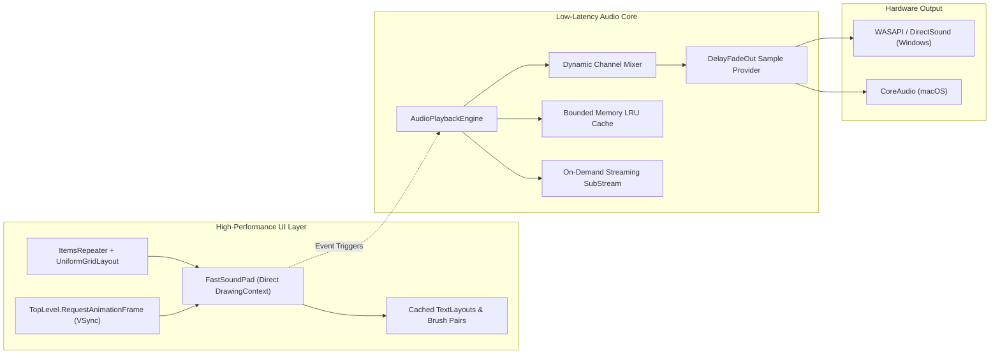

# Soundboard

[](https://dotnet.microsoft.com/)
[](https://avaloniaui.net/)
[](https://github.com/)
[](https://learn.microsoft.com/en-us/dotnet/core/deploying/native-aot/)
[](LICENSE)

> A high-performance, low-latency cross-platform desktop soundboard built with **C# (.NET 10)** and **Avalonia UI**. Engineered for real-time responsiveness, fluid display-synchronized animations, and zero-stutter audio playback across massive sound libraries.

---

## Preview

<div align="center">
  
  <p><em>Modern, dark/light adaptive soundpad grid featuring hierarchical category navigation, real-time playheads, and master audio controls.</em></p>
</div>

---

## Overview

Traditional soundboards are often bloated, sluggish, and prone to audio jitter or UI micro-stutters when handling large sound directories. 

**Soundboard** is engineered from the ground up to solve that problem. Point it to any audio directory on your filesystem, and it recursively scans and transforms your folders into a clean, searchable, and responsive sound pad grid. Designed with live streaming, podcasting, and quick-trigger audio in mind, it combines modern systems programming patterns with high-frequency graphics and low-latency audio mixing.

---

## Highlights & Capabilities

- **Instant Recursive Library Discovery**: Drop in any folder structure. Nested directories are automatically parsed into a hierarchical category sidebar with live search and multi-category filtering.
- **Polyphonic, Zero-Latency Playback**: Overlapping triggers play instantaneously and mix together seamlessly. Retriggering the same sound plays over itself without truncation or clipping.
- **Display-Synchronized Animations**: Pad playheads and elapsed timers update in lockstep with your monitor's native refresh rate (60Hz, 120Hz, 144Hz+) using VSync pacing.
- **Custom Hardware-Accelerated Rendering**: Avoids visual tree bloat by using custom direct-to-canvas rendering for sound pads, allowing fluid interaction even with hundreds of active elements.
- **Adaptive Contrast Theming**: Built-in light and dark themes using perceptual color conversion algorithms (Helmlab color science) to guarantee legibility and contrast across all category badges.
- **Broad Audio Format Compatibility**: Plays MP3, WAV, OGG, and exotic formats like FL Studio Vorbis-in-WAV out of the box.
- **Native AOT & Trimmed Deployment**: Source-generator-backed architecture compiled to standalone native machine code for instant startup and negligible memory footprint.

---

## Technical Architecture & Engineering Highlights

This project serves as a showcase of modern desktop client engineering, focusing on high-throughput graphics, low-latency audio pipelines, and memory efficiency in .NET 10.



### 1. Direct-to-Canvas Fast Rendering (`FastSoundPad`)
Standard XAML controls instantiate dozens of visual elements (`Border`, `TextBlock`, `Shape`) per sound tile. Across a grid with hundreds of sounds, this inflates visual tree traversal costs and triggers layout churn.
- **Bypassed Visual Tree**: Pad tiles are rendered directly through Avalonia's low-level `DrawingContext` via `FastSoundPad`.
- **Text & Resource Caching**: Text layouts (`FormattedText` / `TextLayout`), dynamic drop shadows, and theme brush pairs are pre-computed and cached per font/theme change, dropping per-frame allocations to near zero during active scrolling.

### 2. Display-Synchronized Playhead Animation (VSync)
Rather than relying on inaccurate background timers (e.g. `Task.Delay` or `DispatcherTimer`) that drift and introduce micro-stutters:
- Progress calculation is driven directly by display vertical synchronization via `TopLevel.RequestAnimationFrame`.
- Produces jitter-free progress bar tracking that matches high-refresh displays (120Hz/144Hz) with minimal CPU overhead.

### 3. Non-Blocking, Low-Latency Audio Pipeline
- **Cross-Platform Audio Abstraction**: Multi-targeted driver support leveraging **WASAPI** (shared mode with configurable millisecond latency) and **DirectSound** on Windows, and **CoreAudio** on macOS.
- **Zero-Allocation Read Loops**: File stream allocations and disposal routines are strictly decoupled from real-time audio sample read loops, avoiding garbage collector pauses on the playback thread.
- **Bounded LRU Audio Cache**: Frequently triggered audio clips are held in an in-memory Least Recently Used (LRU) cache with byte/count budgets, falling back to streaming readers for larger audio files.
- **Anti-Pop Smooth Fade In/Out**: Smooth volume fades applied across play and stop events (`DelayFadeOutSampleProvider`) eliminate transient speaker clicks.

### 4. Exotic Codec Demuxing & Non-ANSI File I/O
- **Specific software Vorbis-in-WAV (`0x674F` / `0x6750`)**: Custom parsing via a streaming `SubStream` isolates and decodes raw embedded `OggS` Vorbis streams packaged inside standard WAV headers.
- **Full UTF-16 Unicode Support**: Passes raw .NET `FileStream` handles into native decoders (`libsndfile`), avoiding path encoding corruption across non-ANSI characters, accents, and emojis.

### 5. Native AOT & Modern MVVM
- Powered by `CommunityToolkit.Mvvm` with compiled bindings (`AvaloniaUseCompiledBindingsByDefault`).
- Eliminates runtime reflection in serialization using `System.Text.Json` source generation (`JsonSerializerContext`), enabling full Native AOT compilation profiles with aggressive trimming.

---

## Tech Stack

| Domain | Technology / Library                              | Purpose |
| :--- |:--------------------------------------------------| :--- |
| **Runtime & Language** | C# 13 / .NET 10                                   | Modern language features, Native AOT, cross-platform runtime |
| **UI Framework** | Avalonia UI 12.1                                  | Cross-platform GPU-accelerated desktop UI |
| **UI Architecture** | CommunityToolkit.Mvvm                             | Clean MVVM pattern, compiled bindings, dependency injection |
| **Audio Core** | NAudio, CoreAudio, libsndfile                     | Low-latency drivers (WASAPI, CoreAudio) and multi-codec playback |
| **Typography** | System font stack, Inter Variable & IBM Plex Sans | Tabular figures for jitter-free digital timers |
| **Color Science** | Helmlab Color Conversion                          | Perceptually uniform contrast calculation for UI badges |

---

## Getting Started

### Prerequisites
- [.NET 10 SDK](https://dotnet.microsoft.com/download/dotnet/10.0) or higher.
- Windows 10/11 or macOS 12+.

### Build & Run

```bash
# Clone the repository
git clone https://github.com/your-username/Soundboard.git
cd Soundboard

# Restore and build the project
dotnet build Soundboard.Avalonia/Soundboard.Avalonia.csproj

# Run the application
dotnet run --project Soundboard.Avalonia/Soundboard.Avalonia.csproj
```

### Native AOT Publish (Optimized Binary)

```bash
dotnet publish Soundboard.Avalonia/Soundboard.Avalonia.csproj -c Release -p:PublishAot=true
```

---

## Roadmap

- [x] **Unicode Path Support**: UTF-16 stream handling for accented and foreign paths.
- [x] **FL Studio Vorbis-in-WAV (`0x674F` / `0x6750`)**: Custom demuxing for embedded Vorbis bitstreams.
- [x] **Anti-Pop Fades**: Smooth volume fade in and fade out on trigger / stop.
- [x] **Audio LRU Cache**: Bounded in-memory audio cache with large-file streaming fallback.
- [x] **VSync Playback Engine**: Display-synchronized playhead progress via `RequestAnimationFrame`.
- [x] **Hierarchical Category Navigation**: Recursive directory parsing with tree-based category models.
- [x] **Dynamic Theme System**: Dark/light palettes with perceptual color contrast adaptation.
- [x] **Master Volume Control**: Thread-safe volume attenuation slider and state persistence.
- [ ] **Soundpad Active Playback Counters**: Visual indicators displaying concurrent active playback instances per pad.
- [ ] **Marquee SoundPad Titles**: Smooth hardware-accelerated text scroll for overflowing sound names.
- [ ] **Sidebar Search Polish**: Full-text instant search filtering across categories and pads.
- [ ] **Startup Loading Experience**: Eliminate empty window state on initial directory scan via a lightweight splash/skeleton screen or progressive chunked sound discovery streaming.

---

## License

[GPL-3.0](LICENSE) - free to use, fork, and modify, but derivatives must remain open source and credit this project.
